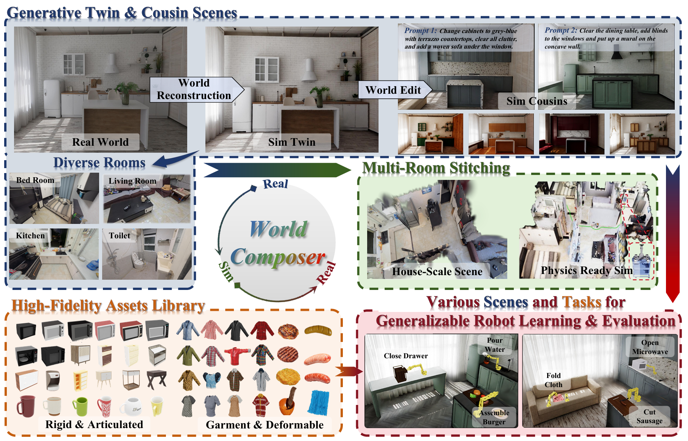

<div align="center">
  <h1>WorldComposer</h1>
  <h3><em>从感知到仿真：基于数字表亲的生成式高保真仿真，用于可泛化的机器人学习与评估</em></h3>
</div>

<div align="center">
    <a href="https://stubborn111.github.io/WorldComposer/Assets/WorldComposer.pdf" target="_blank">
    </a>
    <a href="https://stubborn111.github.io/WorldComposer/" target="_blank">
    </a>
    <a href="https://github.com/jaber628/WorldComposer" target="_blank">
    </a>
</div>

<div align="center">
  
</div>

<div align="center">
  
</div>

---

## ✅ **里程碑**

- **2026.04.17 — WorldComposer 仿真环境与 Real2Sim 流程已发布❗️**
- **2026.05.27 — 完整 Real2Sim 流程已发布❗️**
- **2026.05.27 — 部分仿真资源已发布❗️**

---

## 🌟 **更新计划**

- **完整仿真环境** — 即将发布。
- **AutoCollection 流程** — 即将发布。
- **训练与评估环境** — 即将发布。
- **多房间拼接** — 即将发布。

---

## 🧰 **配套资源**

要启动 WorldComposer 流程，请从 Hugging Face 下载仿真资源，并将 `Assets/` 目录放在仓库根目录：

🔗 **Hugging Face**：[Jaber628/WorldComposer_Assets](https://huggingface.co/datasets/Jaber628/WorldComposer_Assets)

```bash
cd WorldComposer
huggingface-cli download Jaber628/WorldComposer_Assets \
  --repo-type dataset \
  --local-dir . \
  --include "Assets/**"
```

下载完成后，目录结构应为：

```text
WorldComposer/
├── Assets/
├── scripts/
├── source/
├── README.md
├── Real2Sim.sh
└── Teleoperation.sh
```

---

## 🤖 **仿真环境**

### ◆ **安装**

```bash
conda create -n WorldComposer python=3.11
conda activate WorldComposer

pip install torch==2.7.0 torchvision==0.22.0 --index-url https://download.pytorch.org/whl/cu128
pip install "lerobot[all]==0.4.1"
pip install --upgrade pip
pip install 'isaacsim[all,extscache]' --extra-index-url https://pypi.nvidia.com

git clone https://github.com/jaber628/WorldComposer.git
cd WorldComposer
python -m pip install -e source/WorldComposer
```

### ◆ **任务代码结构**

公开任务位于 `source/WorldComposer/WorldComposer/tasks/` 下。

- `Task01_Tableware/`
  - `Tableware.py`：任务环境逻辑、重置行为、随机化、观测与成功判定。
  - `Tableware_cfg.py`：Isaac Lab 环境、机器人、物体、场景与相机配置。
  - `task_config.yaml`：仿真任务、遥操作与自动数据采集设置。
  - `__init__.py`：Gym 任务注册。

每个任务遵循相同结构：环境实现文件、静态配置文件、运行时 YAML 配置与注册入口。

### ◆ **遥操作**

使用 `Teleoperation.sh` 启动已发布的遥操作入口。

```bash
bash Teleoperation.sh
```

### ◆ **自动采集（AutoCollection）**

AutoCollection 是基于同一任务接口构建的自动数据生成流程，将分阶段发布。

---

## 🌌 **Real2Sim 流程**

### ◆ **概述**

WorldComposer Real2Sim 是一套完整的自动化流程，涵盖点云与网格对齐、操作区域识别、操作台面校正以及场景尺度/位姿对齐，将真实采集场景转化为可用于仿真的资源。

### ◆ **安装**

```bash
mkdir -p 3rd
git clone --recursive https://github.com/nv-tlabs/3dgrut.git 3rd/3dgrut
git clone https://github.com/luca-medeiros/lang-segment-anything.git 3rd/lang-segment-anything

cd 3rd/3dgrut
CUDA_VERSION=12 ./scripts/create_conda.sh WorldComposerR2S
conda activate WorldComposerR2S
CUDA_VERSION=12.8.1 ./install_env.sh WorldComposerR2S WITH_GCC11
cd ../..

pip install torch==2.7.0 torchvision==0.22.0 --index-url https://download.pytorch.org/whl/cu128
pip install --upgrade pip
pip install 'isaacsim[all,extscache]' --extra-index-url https://pypi.nvidia.com
pip install open3d trimesh opencv-python segment-anything
pip install -e 3rd/lang-segment-anything

python -m pip install -e source/WorldComposer
```

### ◆ **输入数据**

Real2Sim 从目标环境的真实采集开始，例如单张全景图。我们首先使用**生成式与重建式 3D 世界模型**将采集结果提升为几何场景资源：高斯点云与带纹理网格。

在发布工作流中，我们使用 [***Marble 1.1***](https://marble.worldlabs.ai/) 作为重建后端。导出场景时相机平面设为 `Eye Level`，高质量网格类型设为 `Textured`，得到配对的 `.ply` 与 `.glb` 资源。

请为每个场景组织匹配的文件夹与资源命名：

```text
Assets/scenes/Real2SimScenes/RealScene01
├── RealScene01.ply
└── RealScene01.glb
```

### ◆ **Real2Sim 流程**

已发布的 Real2Sim 入口包含三个阶段：

1. **场景组装**：将 Marble 的 `.ply` 重建转为 USDZ，将 `.glb` 网格转为 USD，并将二者组装为对齐的 USD 场景。
2. **桌面识别**：渲染多视角观测，用语言引导分割识别桌面，并导出桌面点云与元数据。
3. **场景就绪**：拟合桌面平面、压平所选桌面网格顶点、用压平后的网格替换最终场景网格引用，并归一化整体场景位姿，使检测到的桌面在一致的位置与高度上初始化。


最终可用于仿真的场景写入路径为：

```text
${SCENE_DIR}/RealScene01.usd
```

### ◆ **运行**

在 `Real2Sim.sh` 中设置 `SCENE_DIR` 后执行：

```bash
bash Real2Sim.sh
```

---

## ✦  **引用**

若本项研究对您有帮助，欢迎引用：

```bibtex
@misc{lu2026seeingsimulatinggenerativehighfidelity,
  title={From Seeing to Simulating: Generative High-Fidelity Simulation with Digital Cousins for Generalizable Robot Learning and Evaluation}, 
  author={Jasper Lu and Zhenhao Shen and Yuanfei Wang and Shugao Liu and Shengqiang Xu and Shawn Xie and Jingkai Xu and Feng Jiang and Jade Yang and Chen Xie and Ruihai Wu},
  year={2026},
  eprint={2604.15805},
  archivePrefix={arXiv},
  primaryClass={cs.RO},
  url={https://arxiv.org/abs/2604.15805}, 
}
```
