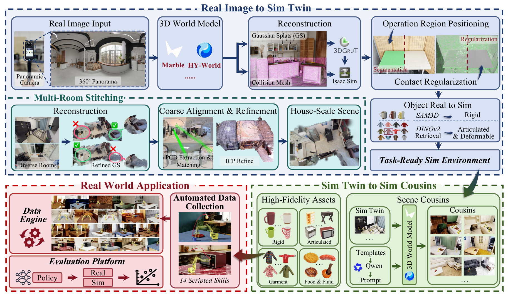

<div align="center">
  <h1>WorldComposer</h1>
  <h3><em>Generative High-Fidelity Simulation with Digital Cousins for Generalizable Robot Learning and Evaluation</em></h3>
</div>

<div align="center">
    <a href="https://arxiv.org/abs/2604.15805v2" target="_blank">
    </a>
    <a href="https://stubborn111.github.io/WorldComposer/" target="_blank">
    </a>
    <a href="https://github.com/jaber628/WorldComposer" target="_blank">
    </a>
</div>

<div align="center">
  
</div>

<div align="center">
  
</div>

---

## ✅ **Milestone**

- **2026.04.17 — WorldComposer Simulation Environment and Real2Sim pipeline released❗️**
- **2026.05.27 — Complete Real2Sim Pipeline released❗️**
- **2026.05.27 — Partial Simulation Assets released❗️**
- **2026.11.24 — Complete Simulation Environment released❗️**
- **2026.11.26 — Multiroom Stitching released❗️**

---

## 🧰 **Companion Assets**

To start the WorldComposer pipeline, download the simulation assets from Hugging Face and place the `Assets/` directory at the repository root:

🔗 **Hugging Face**: [Jaber628/WorldComposer_Assets](https://huggingface.co/datasets/Jaber628/WorldComposer_Assets)

```bash
cd WorldComposer
huggingface-cli download Jaber628/WorldComposer_Assets \
  --repo-type dataset \
  --local-dir . \
  --include "Assets/**"
```

After downloading, the expected layout is:

```text
WorldComposer/
├── Assets/
├── scripts/
├── source/
├── requirements/
├── tests/
├── README.md
├── Real2Sim.sh
├── Stitching.sh
└── Teleoperation.sh
```

---

## 🤖 **Simulation Environment**

### ◆ **Installation**

```bash
conda create -n WorldComposer python=3.11
conda activate WorldComposer

pip install torch==2.7.0 torchvision==0.22.0 --index-url https://download.pytorch.org/whl/cu128
pip install "lerobot[all]==0.4.1"
pip install --upgrade pip
pip install 'isaacsim[all,extscache]' --extra-index-url https://pypi.nvidia.com

git clone https://github.com/jaber628/WorldComposer.git
cd WorldComposer
python -m pip install -e source/WorldComposer
```

### ◆ **Task Code Structure**

Public tasks are organized under `source/WorldComposer/WorldComposer/tasks/`.

Supported tasks include Tableware, Microwave, Drawer, PourWater, Assemble Burger, Cut Sausage, and Fold Cloth.

- `Task01_Tableware/`
  - `Tableware.py`: task environment logic, reset behavior, randomization, observations, and success checking.
  - `Tableware_cfg.py`: Isaac Lab environment, robot, object, scene, and camera configuration.
  - `task_config.yaml`: simulation task and teleoperation settings.
  - `__init__.py`: gym task registration.

Each task follows the same structure: an environment implementation file, a static configuration file, a runtime YAML config, and a registration entry.

### ◆ **Teleoperation**

Use `Teleoperation.sh` to launch the released teleoperation entry.

```bash
bash Teleoperation.sh
```

---

## 🌌 **Real2Sim Pipeline**

### ◆ **Overview**

WorldComposer Real2Sim is a complete automated pipeline for point-cloud and mesh alignment, operation-region recognition, operation-surface rectification, and scene-scale / pose alignment, turning real captured scenes into simulation-ready assets.

### ◆ **Installation**

```bash
mkdir -p 3rd
git clone --recursive https://github.com/nv-tlabs/3dgrut.git 3rd/3dgrut
git clone https://github.com/luca-medeiros/lang-segment-anything.git 3rd/lang-segment-anything

cd 3rd/3dgrut
CUDA_VERSION=12 ./scripts/create_conda.sh WorldComposerR2S
conda activate WorldComposerR2S
CUDA_VERSION=12.8.1 ./install_env.sh WorldComposerR2S WITH_GCC11
cd ../..

pip install torch==2.7.0 torchvision==0.22.0 --index-url https://download.pytorch.org/whl/cu128
pip install --upgrade pip
pip install 'isaacsim[all,extscache]' --extra-index-url https://pypi.nvidia.com
pip install open3d trimesh opencv-python segment-anything
pip install -e 3rd/lang-segment-anything

python -m pip install -e source/WorldComposer
```

### ◆ **Input Data**

Real2Sim starts from a real-world capture of the target environment, such as a single panoramic image. We first use a **generative-and-reconstructive 3D world model** to lift this capture into geometric scene assets: a Gaussian point cloud and a textured mesh.

In our release workflow, [***Marble 1.1***](https://marble.worldlabs.ai/) is used as the reconstruction backend. We export the scene with the camera plane set to `Eye Level` and the high-quality mesh type set to `Textured`, producing the paired `.ply` and `.glb` assets.

Organize each scene with matching folder and asset names:

```text
Assets/scenes/Real2SimScenes/RealScene01
├── RealScene01.ply
└── RealScene01.glb
```

### ◆ **Real2Sim Pipeline**

The released Real2Sim entry runs three stages:

1. **Scene assembly**: converts the Marble `.ply` reconstruction to USDZ, converts the `.glb` mesh to USD, and assembles both into an aligned USD scene.
2. **Tabletop recognition**: renders multiview observations, uses language-guided segmentation to identify the tabletop, and exports the tabletop point clouds and metadata.
3. **Scene readiness**: fits the tabletop plane, flattens the selected tabletop mesh vertices, replaces the final scene mesh reference with the flattened mesh, and normalizes the whole scene pose so the detected tabletop is initialized at a consistent location and height.


The final simulation-ready scene is written as:

```text
${SCENE_DIR}/RealScene01.usd
```

### ◆ **Run**

After setting `SCENE_DIR` in `Real2Sim.sh`, run:

```bash
bash Real2Sim.sh
```

---

## 🧩 **Multiroom Stitching**

WorldComposer aligns adjacent Gaussian scenes from panoramic images, refines their overlap using original views, and supports keyboard navigation with RGB-D visualization.

### ◆ **Installation**

Clone the simulation environment and install the stitching dependencies:

```bash
conda create -n WorldComposerNav --clone WorldComposer
conda activate WorldComposerNav

export CUDA_HOME=/usr/local/cuda
export PATH="$CUDA_HOME/bin:$PATH"
python -m pip install -r requirements/stitching.txt
python -m pip install -e source/WorldComposer
```

Navigation uses Isaac Sim 5.1 and GSplat. GSplat builds its CUDA extension on the first run.

### ◆ **Input Data**

The companion assets include a sample scene pair and a stitched navigation scene. To stitch your own adjacent scenes, organize their panoramas and Gaussian reconstructions using the same layout:

```text
Assets/scenes/MultiroomScenes/MultiRoom01/
├── input/
│   ├── pano/
│   │   ├── scene_01.png
│   │   └── scene_02.png
│   └── scenes/
│       ├── scene_01.ply
│       └── scene_02.ply
├── stitched/
│   ├── merged.ply
│   ├── pair_transform.json
│   ├── provenance.npz
│   ├── refinement_report.json
│   ├── scene_config.yaml
│   ├── grid_map.png
│   └── grid_meta.json
└── preview/
```

### ◆ **Run**

Set `SCENE_DIR` to the provided example or your own scene directory, then run alignment, surface fusion, view-guided refinement, and navigation preparation:

```bash
SCENE_DIR=Assets/scenes/MultiroomScenes/MultiRoom01
OUTPUT_DIR=outputs/stitching

bash Stitching.sh "$SCENE_DIR" "$OUTPUT_DIR"
python scripts/stitching/nav_teleop.py --scene-dir "$OUTPUT_DIR/stitched"
```

To navigate the provided scene directly:

```bash
python scripts/stitching/nav_teleop.py \
  --scene-dir Assets/scenes/MultiroomScenes/MultiRoom01/stitched
```

Use `W` to move forward, `A`/`D` to turn, `S` to stop, and `Q`/`Esc` to exit.

---

## ✦  **Citation**

If you find this project useful in your research, please consider citing:

```bibtex
@misc{lu2026worldcomposergenerativehighfidelitysimulation,
  title={WorldComposer: Generative High-Fidelity Simulation with Digital Cousins for Generalizable Robot Learning and Evaluation},
  author={Jasper Lu and Zhenhao Shen and Yuanfei Wang and Shugao Liu and Shengqiang Xu and Shawn Xie and Jingkai Xu and Feng Jiang and Jade Yang and Chen Xie and Ruihai Wu},
  year={2026},
  eprint={2604.15805},
  archivePrefix={arXiv},
  primaryClass={cs.RO},
  url={https://arxiv.org/abs/2604.15805}, 
}
```
